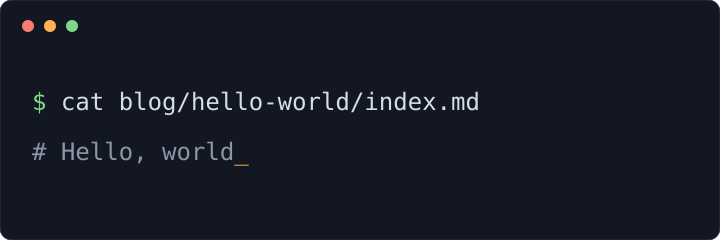

This post is a **draft**. It is built and reachable at `/blog/hello-world` so you can send the link to a proofreader, but it does not appear in the blog index, the nav dropdown, the front page, or the RSS feed. Set `draft: false` in the front matter (or delete the line) to publish it.

## Folder per post

This post lives at `src/content/blog/hello-world/index.md`. Images dropped into the same folder can be referenced with relative paths and are optimized at build time:



A post that has no images can be a single file, `src/content/blog/<slug>.md`. Either way the file or folder name becomes the URL.

## Code

Code blocks are highlighted at build time, no client-side JavaScript involved:

```ts
import { onRequest } from "firebase-functions/https";

export const hello = onRequest((req, res) => {
  res.send("hello from inlined.dev");
});
```
